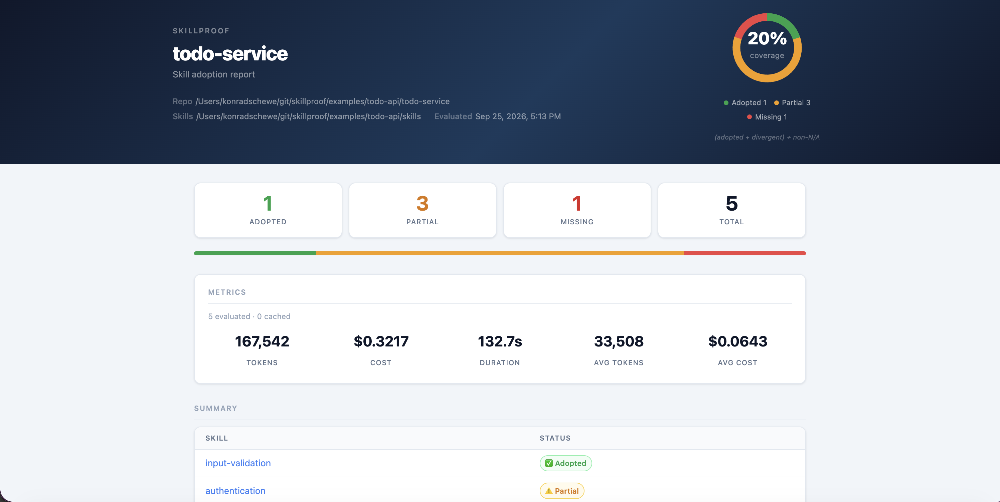

# Prove That Your Codebase Adopts the Skills

*A new pattern for verifying coding agent output across teams.*

---

Your platform team spent weeks writing the perfect skill. Authentication patterns. Error handling conventions. Audit logging requirements. The coding agents on every consumer team received it. They read it. They implemented the service.

But did they actually follow it?

---

## The gap between skills and adoption

Coding agents are remarkably good at using skills as context. Give an agent a `SKILL.md` describing how to implement authentication, and it will produce code that looks right. But "looks right" and "is right" are different things — and today there is no systematic way to tell them apart.

Teams discover drift in one of two ways: during a code review, if someone happens to notice. Or after an incident.

Neither is acceptable when you're responsible for a platform that dozens of teams depend on.

---

## A new pattern: provider distributes, agent implements, Skillproof verifies

The pattern works like this.

A **provider team** — the team that owns a core service, a platform component, or a set of internal standards — writes skills as `SKILL.md` files. Each skill is plain markdown describing what a consumer's implementation should look like: which APIs to call, which patterns to follow, what behaviors are required.

Consumer teams add these skills to their repositories. Their coding agent uses them as context while building the integration. That's the existing workflow — skills as development guidance.

**Skillproof adds the missing half**: it uses an LLM to evaluate whether the resulting codebase actually implements what the skill describes. The same artifact that guided the coding agent becomes the specification for the conformance check.

```
Provider Team
      │
      │  publishes
      ▼
SKILL.md files
      │
      ├──────────────────────────────┐
      │                              │
      ▼                              ▼
🤖 Coding Agent               Skillproof
      │                              │
      ▼                              │
Consumer Codebase ─────────────────► │
                                     ▼
                           ✅ adopted
                           ⚠️ partial
                           🔵 divergent
                           ❌ missing
```

---

## What the report looks like

Here's a real example. A platform team distributes five backend standards as skills to a team building a Todo API with a coding agent:



The coding agent implemented input validation correctly. But authentication is only partial — the `DELETE` route has no auth middleware. Authorization is missing entirely. Audit logging was never implemented.

None of this would surface in a typical code review. The code compiles. The tests pass. The agent was confident. Skillproof found it in 133 seconds for $0.32.

The full breakdown:

| Skill | Status | What Skillproof found |
|---|---|---|
| `input-validation` | ✅ adopted | Zod `.safeParse()` used correctly on all request bodies |
| `authentication` | ⚠️ partial | `DELETE /todos/:id` has no `authenticate` middleware |
| `error-responses` | ⚠️ partial | 401 and 404 errors use `{ message }` instead of `{ error: { code, message } }` |
| `authorization` | ⚠️ partial | No ownership check — any user can modify any todo |
| `audit-logging` | ❌ missing | No `auditLog()` calls anywhere in the codebase |

The example is available at [`examples/todo-api`](../examples/todo-api) — you can run it yourself with any Anthropic API key.

---

## Why this matters now

Coding agents are becoming the default way teams build software. That shift has a consequence most teams haven't fully reckoned with yet: the agent writes code that passes review and tests, but nobody has systematically checked whether it followed the organization's standards.

Skills were designed to solve the "what to build" problem. Skillproof solves the "did it get built correctly" problem.

For platform teams, this means you can prove to your organization — to management, to auditors, to the teams that depend on you — that the services consuming your platform actually implement the required patterns. Not "we distributed a skill and trust that teams followed it." Verified.

For consumer teams, it means you have a feedback loop when the platform team updates a skill. Run Skillproof on a schedule. When a skill changes, the next run tells you exactly what needs to be updated in your codebase — before an incompatibility surfaces in production.

---

## Skillproof is not a linter

It's worth being precise about what Skillproof is and is not.

A linter checks syntax and patterns that can be expressed as deterministic rules. Skillproof evaluates *intent* — whether the implementation follows the practices described in natural language. It can reason about things no linter can express:

> "Use `CustomerGateway` to resolve customer identity. Do not access the persistence layer directly. Propagate errors using the standard domain error model."

That's not a rule. It's a design decision. And an LLM can evaluate whether the code follows it.

This places Skillproof in an emerging category that architecture practitioners are starting to call *agentic fitness functions*: LLM-based evaluators that check whether codebases conform to architectural and implementation intent. The concept extends traditional architecture fitness functions — automated checks on architectural properties — to the kinds of rich, semantic practices that teams increasingly express as agent skills.

---

## Getting started

```bash
export ANTHROPIC_API_KEY=your-api-key

npx @skillproof/cli \
  --skills-dir ./skills \
  --output-format html \
  --output-file report.html
```

Or use the [GitHub Action](https://github.com/konradschewe/skillproof-action) to run on a schedule and publish the report to GitHub Pages:

```yaml
- uses: konradschewe/skillproof-action@v1
  with:
    skills-dir: ./skills
    anthropic-api-key: ${{ secrets.ANTHROPIC_API_KEY }}
    publish-pages: true
```

→ [Full documentation and example](https://github.com/konradschewe/skillproof)
